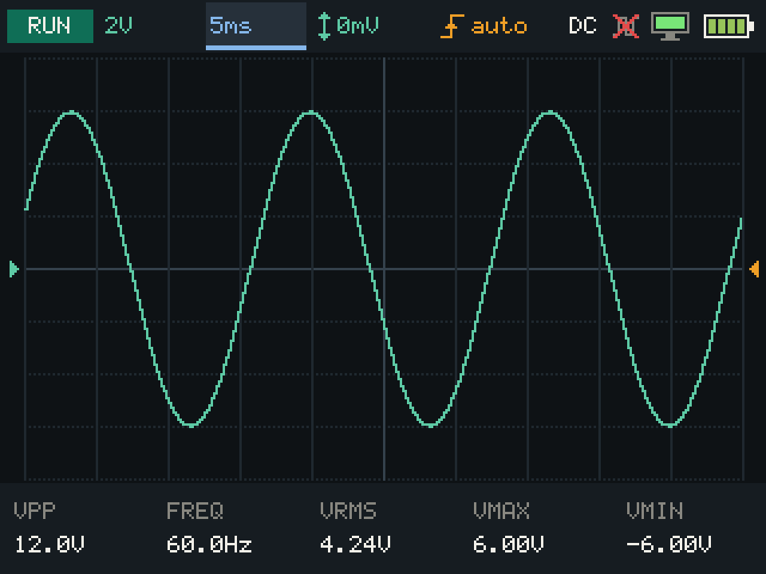
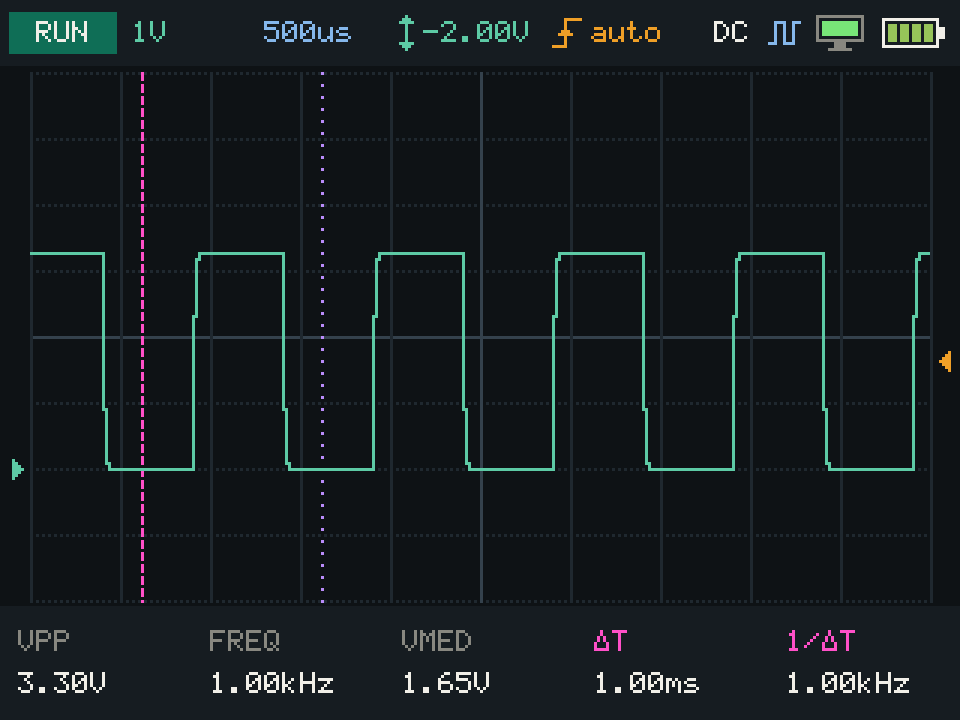
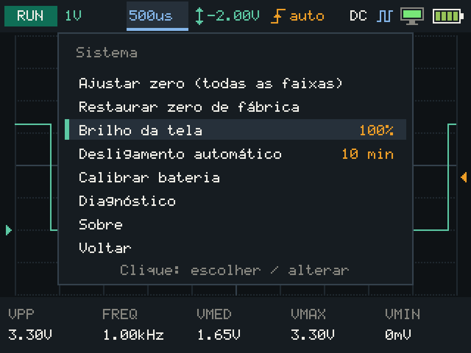
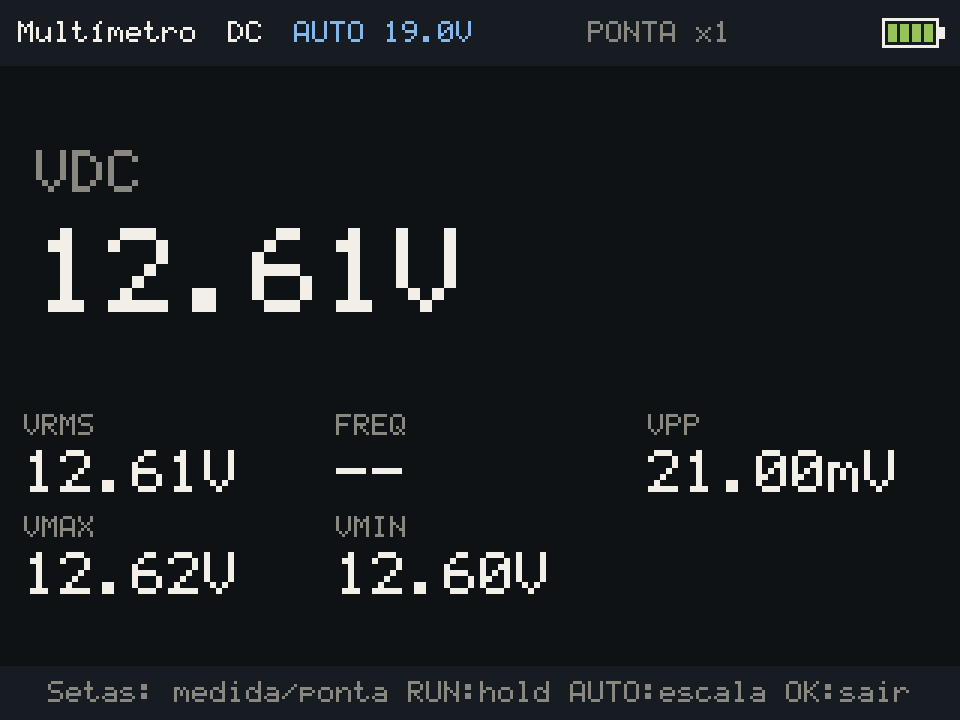
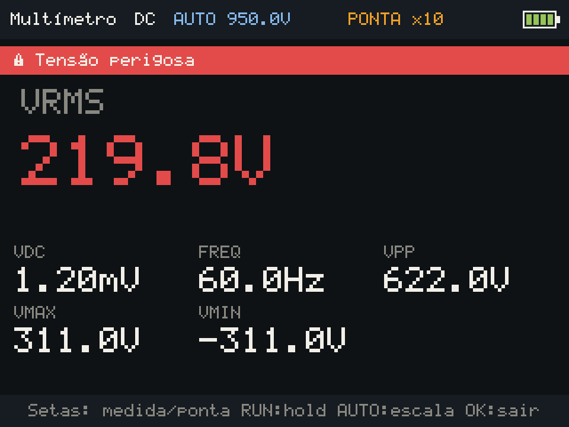
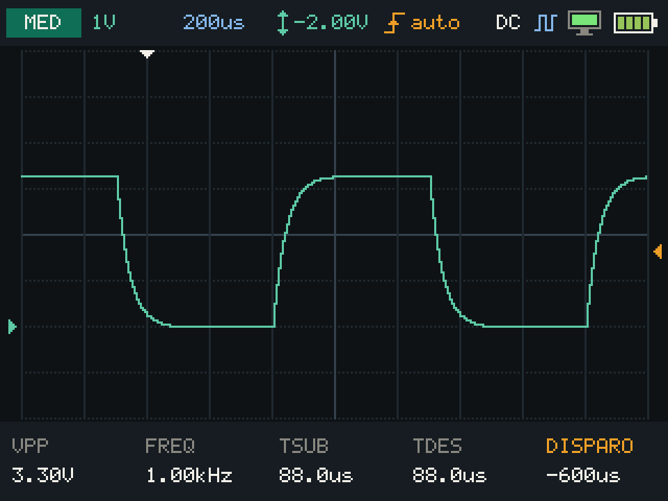
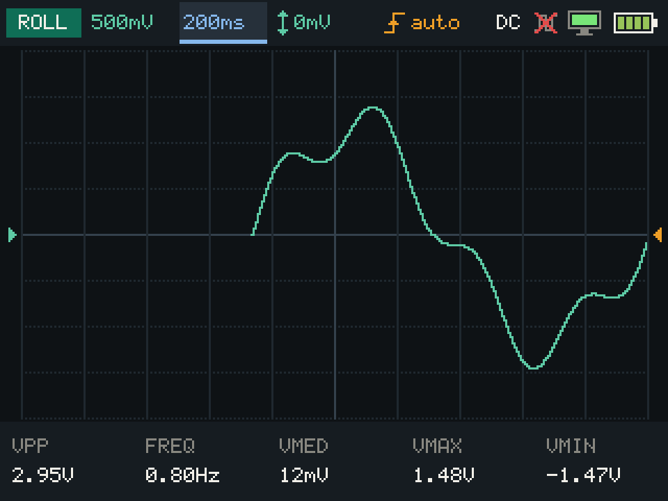
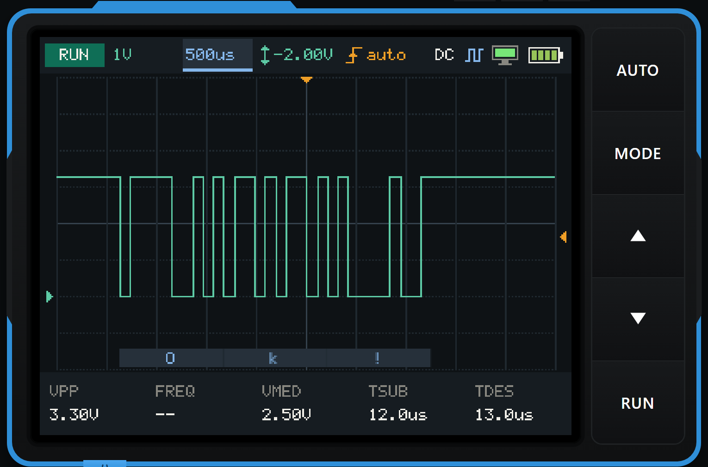
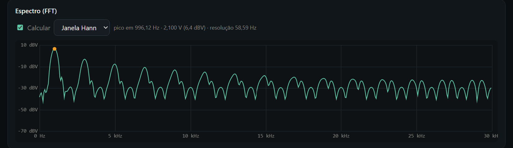
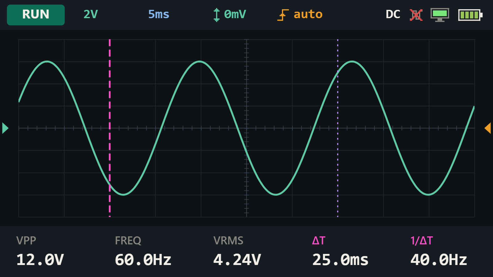

# DSO152 — firmware alternativo

Firmware novo e completo para o osciloscópio de bolso **FNIRSI DSO-152**, com interface
redesenhada, menus em português e uma **tela no PC** pelo USB, que abre direto no navegador
sem instalar nada.

Autor: **Carlos Santa Kich** · Licença: [MIT](LICENSE) · Versão atual: **v2.1**
([notas de versão](CHANGELOG.md))

> **Reversível.** O bootloader da FNIRSI não é alterado. Para voltar ao firmware original,
> basta instalar o arquivo da FNIRSI do mesmo jeito que se instala este.

<p align="center"></p>

## Motivação

O DSO-152 é um osciloscópio de bolso de baixo custo com hardware capaz, mas o firmware original
tem uma interface pouco intuitiva, poucas funções e nenhuma ligação com o PC além da atualização.
Este projeto substitui o aplicativo por um firmware escrito do zero, com dois objetivos: tornar o
aparelho prático no uso diário e permitir operá-lo pelo PC como um osciloscópio de bancada, com
tela grande, acesso às configurações, histórico e exportação.

## O que ele faz

**No aparelho**
- Barra superior com estado (RUN / MED / NORM / SNGL / ROLL / STOP), V/div, tempo/div, posição,
  trigger, DC/AC, gerador, conexão com o PC e bateria (com animação de carga).
- Escalas de **10 mV a 20 V/div** e de **20 µs a 2 s/div**. De 50 ms/div em diante, **modo
  rolagem**: a onda corre da direita para a esquerda, sem esperar o trigger.
- Trigger Auto, Normal e Single; borda de subida ou descida; nível automático ou manual;
  **posição do disparo** ajustável (pré-trigger) e, parado, navegação pela captura.
- **Média de capturas** (4, 8 ou 16) para limpar o ruído de sinais repetitivos.
- **AUTO** (ajuste automático) que acerta escala, posição e base de tempo, inclusive para
  sinais lentos, de poucos hertz.
- Medidas à escolha nas cinco posições da barra de baixo: VPP, frequência, período,
  duty cycle, média, RMS verdadeiro, máximo, mínimo, **tempo de subida** e **de descida**.
- **Multímetro**: Vdc, Vrms, frequência, Vpp, máximo e mínimo ao mesmo tempo, com escala
  automática ou fixa e HOLD.
- **Aviso de tensão perigosa** (60 V DC, 30 V RMS ou 42 V de pico em AC) e aviso para usar a
  ponta x10 acima de 35 V em x1.
- **Cursores** de tempo (ΔT e 1/ΔT) e de tensão (C1, C2 e ΔV).
- **Gerador** de onda quadrada / PWM no conector de saída: frequências de 10 Hz a 100 kHz e
  duty de 10 a 90 % no menu; pelo PC, de 1 Hz a 200 kHz e duty de 1 a 99 %.
- Ponta x1 / x10, ajuste de zero de todas as faixas, restauração do zero de fábrica.
- Desligamento automático por inatividade (só na bateria), brilho da tela ajustável,
  calibração da leitura da bateria, tela de diagnóstico e tela Sobre.
- Aviso "FORA DA ESCALA" quando o sinal passa da tela.

**No PC** (página `pc/dso152_pc.html`, Chrome ou Edge)
- A mesma tela do aparelho, pixel a pixel, com os botões ao lado como no aparelho.
- **Tela cheia** em alta resolução e formato wide.
- Clique nos valores para escolher em uma lista (V/div, tempo/div, posição, trigger,
  gerador, medidas, cursores); clique em RUN para parar ou continuar.
- O menu de configurações do aparelho aparece e pode ser operado pelo PC.
- **Histórico** das últimas 3000 capturas, para voltar a ondas anteriores.
- **Exportar** a tela em PNG (1920×1080) e a onda em CSV (abre direto no Excel).
- **Registrador**: gráfico de uma medida ao longo do tempo (minutos ou horas),
  com mínimo, máximo e média, exportável em CSV.
- **Espectro (FFT)**, **decodificação serial (UART)**, **onda de referência** para comparar e
  **gravação de vídeo** (WebM).
- Gerador com frequência e duty digitados, e a frequência realmente gerada.
- Tela do multímetro, aviso de tensão perigosa e botão para desligar o aparelho.

## Telas

Imagens geradas pela própria página do PC, que desenha a tela do aparelho pixel a pixel.

<table>
<tr>
<td><br><sub>Onda quadrada de 1 kHz (gerador do próprio aparelho)</sub></td>
<td><br><sub>Senoide de 60 Hz, com VRMS na barra de medidas</sub></td>
</tr>
<tr>
<td><br><sub>Cursores de tempo: ΔT e 1/ΔT (o selecionado fica rosa)</sub></td>
<td><br><sub>Cursores de tensão: C1, C2 e ΔV</sub></td>
</tr>
<tr>
<td><br><sub>Menu de configurações</sub></td>
<td><br><sub>Sistema: brilho, desligamento automático, bateria, diagnóstico, Sobre</sub></td>
</tr>
<tr>
<td><br><sub>Multímetro: bateria de 12 V</sub></td>
<td><br><sub>Rede elétrica com a ponta x10: valor em vermelho e aviso</sub></td>
</tr>
<tr>
<td><br><sub>Posição do disparo, média de capturas, subida e descida</sub></td>
<td><br><sub>Aviso de tensão perigosa no rodapé</sub></td>
</tr>
<tr>
<td><br><sub>Modo rolagem (50 ms/div a 2 s/div)</sub></td>
<td><br><sub>Aviso quando o sinal passa da tela</sub></td>
</tr>
</table>

**Decodificação UART e espectro no PC:**

<p align="center"></p>
<p align="center"></p>

**Tela cheia no PC**, em alta resolução e formato wide:

<p align="center"></p>

**Registrador**: uma medida ao longo do tempo (aqui, a tensão de uma bateria de 12 V sob carga por 40 minutos):

<p align="center"></p>

## Instalação

1. Desligue o aparelho e ligue-o ao computador com um cabo USB **de dados**.
2. **Segure OK e ligue.** Aparece no computador o drive **DSO BOOT**.
3. Copie o arquivo **`DSO152_APP_V0.1.bin`** (da página de *Releases*) para o drive.
   O aparelho desliga quando termina.
4. Ligue-o normalmente, no botão de liga/desliga.

**Voltar ao original:** repita os passos com o arquivo da FNIRSI.

> O arquivo da release contém, no endereço 0x08008000–0x080099FF, os bytes da fonte que o
> bootloader da FNIRSI usa para desenhar a própria tela (o bootloader lê essa fonte de dentro
> da área do aplicativo). Eles vêm do arquivo original da FNIRSI, sem alteração, e servem só
> para a tela do DSO BOOT continuar legível. O código deste projeto não os usa.

## Usando a tela no PC

1. Ligue o aparelho ao PC pelo USB. O ícone do PC na tela fica **amarelo** (PC conectado,
   porta fechada). No Windows ele aparece como *Dispositivo serial USB (COMx)*, com o driver
   do próprio Windows.
2. Baixe `dso152_pc.html` (pasta `pc/` ou página de *Releases*) e abra no **Chrome** ou no **Edge** (o Firefox não tem Web Serial).
3. Clique em **Conectar** e escolha a porta. O ícone fica com a tela **verde**.

Teclado do PC: setas, Enter = OK, M = MODE, A = AUTO, espaço = RUN/STOP, F = tela cheia.

> **Segurança:** pelo USB, a garra (jacaré) da ponta fica ligada ao terra do PC. **Nunca**
> meça a rede elétrica com o aparelho ligado ao PC ou ao carregador.

## Botões

| Botão | Função |
|---|---|
| ◄ ► | escolhe o que ▲ ▼ ajustam: V/div, tempo/div, posição, trigger, disparo (e os cursores) |
| ▲ ▼ | muda o valor escolhido |
| MODE | DC / AC |
| RUN | roda / para (em Single, arma de novo) |
| AUTO | ajuste automático |
| OK | menu de configurações |
| liga/desliga (segurar 2 s) | desliga |

## Compilando

Precisa do [PlatformIO](https://platformio.org/) (extensão do VS Code ou `pip install platformio`).

1. Coloque o arquivo original da FNIRSI em `stock/DSO152_APP_V0.1.bin`, ou informe o
   caminho na variável de ambiente `DSO152_STOCK`. O bootloader da FNIRSI desenha a própria
   tela com uma fonte que fica dentro da área do aplicativo (0x08008000–0x080099FF), e
   esses bytes são copiados do arquivo original para o arquivo final. Sem ele, a tela do
   bootloader aparece com barras, mas o drive DSO BOOT funciona.
2. `pio run`
3. O arquivo pronto fica em `out/DSO152_APP_V0.1.bin`. Para copiá-lo também para outra
   pasta, use `DSO152_DROP` ou escreva a pasta em `tools/drop_dir.txt`.

A página do PC é gerada a partir de `tools/page_template.html` com a fonte do aparelho:
`python tools/mkpage.py pc/dso152_pc.html`.

## Notas de desenvolvimento

- **Sem abrir o aparelho e sem alterar o bootloader.** A instalação usa o drive *DSO BOOT*
  original, então é sempre reversível. O mapa de pinos (tela paralela de 16 bits, ADC com TIM1 e
  DMA, relé e 74HC4051 das 11 faixas, gerador, bateria) foi levantado a partir do firmware
  original e de projetos da comunidade.
- **Convivência com o bootloader.** O aplicativo é ligado em 0x08003C00. O bootloader desenha a
  própria tela com uma fonte que fica dentro da área do aplicativo (0x08008000–0x080099FF), e esse
  trecho é preservado. Por isso o linker divide o código em duas regiões ao redor dele.
- **Flash limitada.** Interface, menus, USB, cursores, medidas e multímetro cabem em cerca de 45 KB.
- **Calibração.** O ganho das 11 faixas foi aferido com multímetro. O zero de fábrica é lido da
  área de calibração da FNIRSI (0x0800FC00), que nunca é gravada.
- **USB CDC sem biblioteca.** Driver escrito direto nos registradores do periférico USB. O
  aparelho aparece como porta serial com o driver nativo do sistema, e a página do PC usa Web
  Serial, sem instalação.
- **AUTO para sinais lentos.** A amplitude é medida em uma janela curta e em outra longa antes de
  escolher a escala, para acertar de primeira também em sinais de poucos hertz.
- **Validação no hardware**, versão por versão, da v0.1 (relógio, tela e botões) à v2.1.

## Hardware (o que este firmware usa)

- CH32F103 (compatível com STM32F103), 64 KB de flash, 20 KB de RAM, cristal de 8 MHz
  → 72 MHz. O aplicativo fica em 0x08003C00 (o bootloader da FNIRSI vem antes).
- Configurações em 0x0800F800; a calibração da FNIRSI em 0x0800FC00 só é lida, nunca gravada.
- Tela ST7789 320×240 em barramento paralelo de 16 bits (GPIOB).
- ADC1 canal 1 (PA1) a até 2,4 MSa/s, disparado pelo TIM1 e lido por DMA.
- Entrada: relé PA2, acoplamento PA3, multiplexador 74HC4051 em PA4–PA6 (11 faixas).
- Gerador: PA0 (TIM2). Bateria: PA7. Luz da tela: PC9 (TIM3, PWM).
- USB: bloco USB do chip, como porta serial CDC (VID 0483, PID 5740).

## Protocolo USB (para quem quiser fazer outro programa)

Linhas de texto. Do aparelho para o PC, enquanto a porta estiver aberta (DTR):

```
I DSO152 v2.1                                         identificação
W <Sa/s> <us/div> <mV/div> <ponta> <dc> <zero> <contagens/V> <trigger> <roll> <n>
D <n amostras, 3 dígitos hexadecimais cada, contagens do ADC>
M <vpp> <freq mHz> <média> <máx> <mín> <rms> <duty 0,1 %> <subida> <descida>  (mV na ponta, 0,1 µs)
S <estado: run, trigger, seleção, posição, cursores, gerador, bateria, medidas, duty,
   frequência real, média, posição do disparo>
U 0 | U 1 <item>\t<título>\t<nome>\t<valor>... | U 2 <título> | U 3 (multímetro)
V <vdc> <vrms> <freq mHz> <vpp> <vmax> <vmin> (µV na ponta) <destaque> <hold> <escala> ...
```

Do PC para o aparelho: `K U|D|L|R|O|M|A|S` aperta um botão; `C <x> <n>` muda um valor
(V, T, P, L, C, E, M, X, G, U, R, S, Q, I, F, Y, A, H, Z — veja `pc_keys` em `src/main.c`).

## Agradecimentos

- Os projetos de [zeromem0](https://github.com/zeromem0) para o DSO-152 (dso152-usb,
  dso152-tester232-usb) mostraram que o USB deste chip funciona como porta serial e quais
  cuidados ele pede.
- [dso152-breakout](https://github.com/davidgiven/dso152-breakout), de David Given.

Este projeto não tem relação com a FNIRSI. FNIRSI e DSO-152 são marcas dos seus donos.
