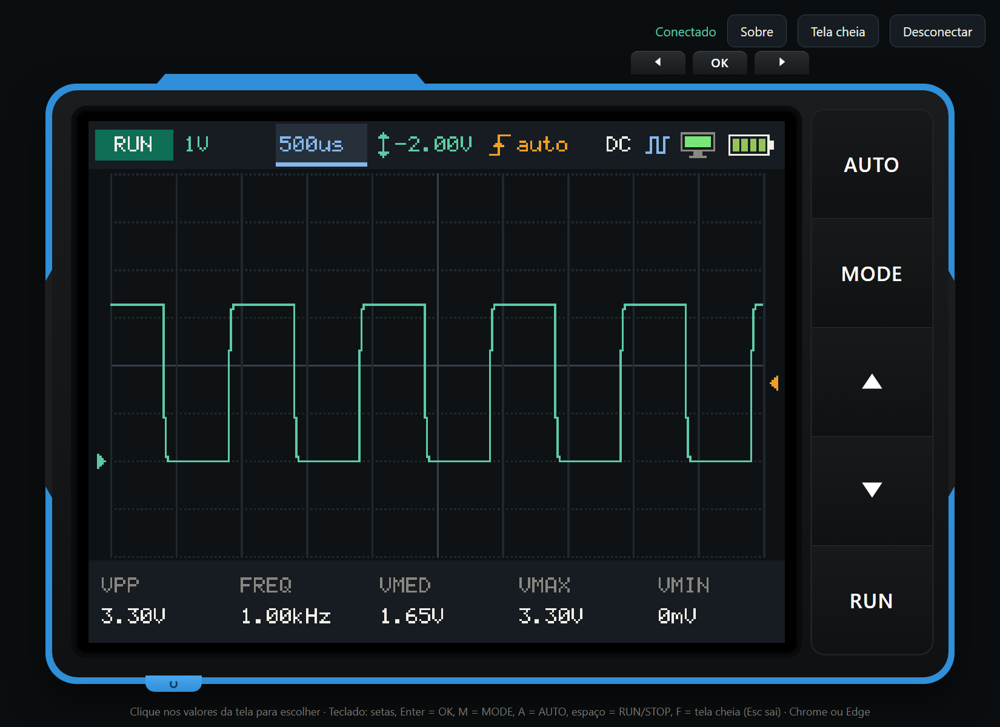
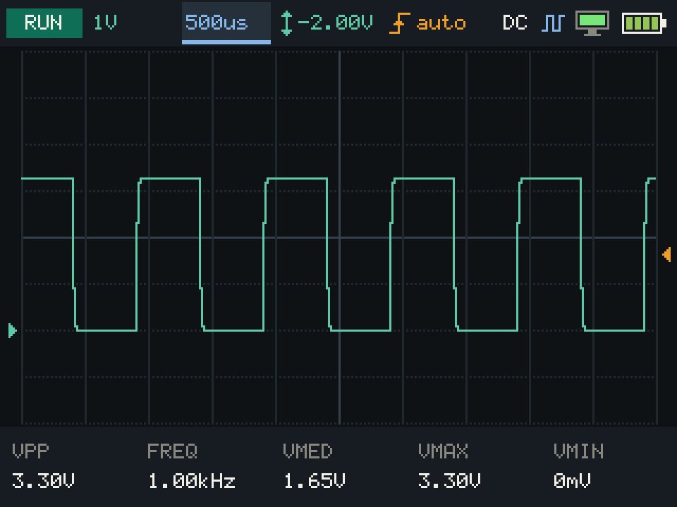
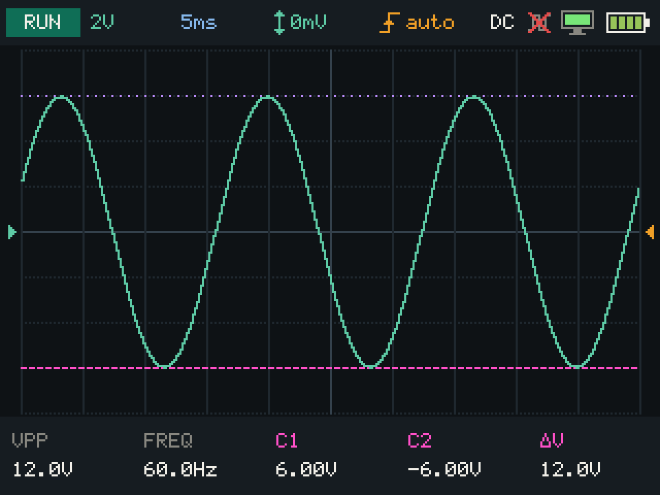
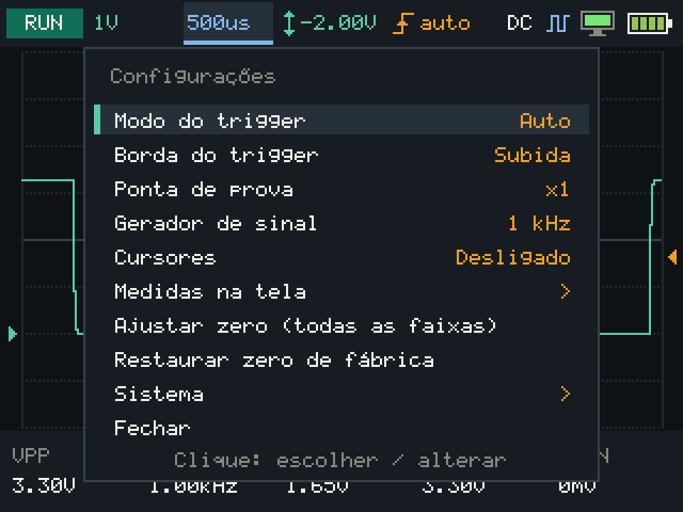
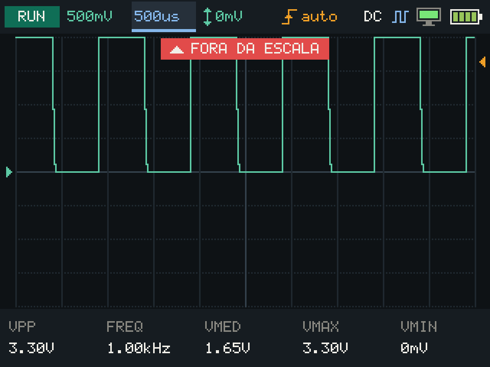
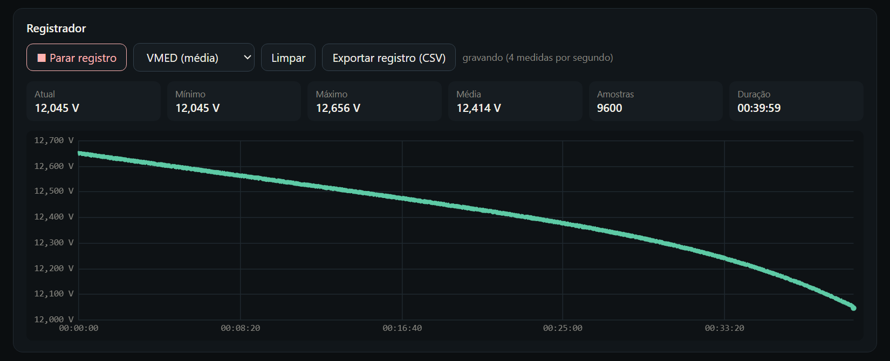

# DSO152 — firmware alternativo

Firmware novo e completo para o osciloscópio de bolso **FNIRSI DSO-152**, com interface
redesenhada, menus em português e uma **tela no PC** pelo USB, que abre direto no navegador
sem instalar nada.

Autor: **Carlos Santa Kich** · Licença: [MIT](LICENSE) · Versão atual: **v2.0**
([notas de versão](CHANGELOG.md))

> **Reversível.** O bootloader da FNIRSI não é alterado. Para voltar ao firmware original,
> basta instalar o arquivo da FNIRSI do mesmo jeito que se instala este.

<p align="center"></p>

## O que ele faz

**No aparelho**
- Barra superior com estado (RUN / NORM / SNGL / ROLL / STOP), V/div, tempo/div, posição,
  trigger, DC/AC, gerador, conexão com o PC e bateria (com animação de carga).
- Escalas de **10 mV a 20 V/div** e de **20 µs a 2 s/div**. De 50 ms/div em diante, **modo
  rolagem**: a onda corre da direita para a esquerda, sem esperar o trigger.
- Trigger Auto, Normal e Single; borda de subida ou descida; nível automático ou manual.
- **AUTO** (ajuste automático) que acerta escala, posição e base de tempo, inclusive para
  sinais lentos, de poucos hertz.
- Medidas à escolha nas cinco posições da barra de baixo: VPP, frequência, período,
  duty cycle, média, RMS verdadeiro, máximo e mínimo.
- **Cursores** de tempo (ΔT e 1/ΔT) e de tensão (C1, C2 e ΔV).
- Gerador de onda quadrada (10 Hz a 100 kHz) no conector de saída.
- Ponta x1 / x10, ajuste de zero de todas as faixas, restauração do zero de fábrica.
- Desligamento automático por inatividade (só na bateria), brilho da tela ajustável,
  calibração da leitura da bateria, tela de diagnóstico e tela Sobre.
- Aviso "FORA DA ESCALA" quando o sinal passa da tela.

**No PC** (página `pc/dso152_pc.html`, Chrome ou Edge)
- A mesma tela do aparelho, pixel a pixel, com os botões ao lado como no aparelho.
- **Tela cheia** em alta resolução e formato wide.
- Clique nos valores para escolher em uma lista (V/div, tempo/div, posição, trigger,
  gerador, medidas, cursores); clique em RUN para parar ou continuar.
- O menu de configurações do aparelho aparece e pode ser operado pelo PC.
- **Histórico** das últimas 3000 capturas, para voltar a ondas anteriores.
- **Exportar** a tela em PNG (1920×1080) e a onda em CSV (abre direto no Excel).
- **Registrador**: gráfico de uma medida ao longo do tempo (minutos ou horas),
  com mínimo, máximo e média, exportável em CSV.

## Telas

Imagens geradas pela própria página do PC, que desenha a tela do aparelho pixel a pixel.

<table>
<tr>
<td><br><sub>Onda quadrada de 1 kHz (gerador do próprio aparelho)</sub></td>
<td><br><sub>Senoide de 60 Hz, com VRMS na barra de medidas</sub></td>
</tr>
<tr>
<td><br><sub>Cursores de tempo: ΔT e 1/ΔT (o selecionado fica rosa)</sub></td>
<td><br><sub>Cursores de tensão: C1, C2 e ΔV</sub></td>
</tr>
<tr>
<td><br><sub>Menu de configurações</sub></td>
<td><br><sub>Sistema: brilho, desligamento automático, bateria, diagnóstico, Sobre</sub></td>
</tr>
<tr>
<td><br><sub>Modo rolagem (50 ms/div a 2 s/div)</sub></td>
<td><br><sub>Aviso quando o sinal passa da tela</sub></td>
</tr>
</table>

**Tela cheia no PC**, em alta resolução e formato wide:

<p align="center"></p>

**Registrador**: uma medida ao longo do tempo (aqui, a tensão de uma bateria de 12 V sob carga por 40 minutos):

<p align="center"></p>

## Instalação

1. Desligue o aparelho e ligue-o ao computador com um cabo USB **de dados**.
2. **Segure OK e ligue.** Aparece no computador o drive **DSO BOOT**.
3. Copie o arquivo **`DSO152_APP_V0.1.bin`** (da página de *Releases*) para o drive.
   O aparelho desliga quando termina.
4. Ligue-o normalmente, no botão de liga/desliga.

**Voltar ao original:** repita os passos com o arquivo da FNIRSI.

> O arquivo da release contém, no endereço 0x08008000–0x080099FF, os bytes da fonte que o
> bootloader da FNIRSI usa para desenhar a própria tela (o bootloader lê essa fonte de dentro
> da área do aplicativo). Eles vêm do arquivo original da FNIRSI, sem alteração, e servem só
> para a tela do DSO BOOT continuar legível. O código deste projeto não os usa.

## Usando a tela no PC

1. Ligue o aparelho ao PC pelo USB. O ícone do PC na tela fica **amarelo** (PC conectado,
   porta fechada). No Windows ele aparece como *Dispositivo serial USB (COMx)*, com o driver
   do próprio Windows.
2. Baixe `dso152_pc.html` (pasta `pc/` ou página de *Releases*) e abra no **Chrome** ou no **Edge** (o Firefox não tem Web Serial).
3. Clique em **Conectar** e escolha a porta. O ícone fica com a tela **verde**.

Teclado do PC: setas, Enter = OK, M = MODE, A = AUTO, espaço = RUN/STOP, F = tela cheia.

> **Segurança:** pelo USB, a garra (jacaré) da ponta fica ligada ao terra do PC. **Nunca**
> meça a rede elétrica com o aparelho ligado ao PC ou ao carregador.

## Botões

| Botão | Função |
|---|---|
| ◄ ► | escolhe o que ▲ ▼ ajustam: V/div, tempo/div, posição, trigger (e os cursores) |
| ▲ ▼ | muda o valor escolhido |
| MODE | DC / AC |
| RUN | roda / para (em Single, arma de novo) |
| AUTO | ajuste automático |
| OK | menu de configurações |
| liga/desliga (segurar 2 s) | desliga |

## Compilando

Precisa do [PlatformIO](https://platformio.org/) (extensão do VS Code ou `pip install platformio`).

1. Coloque o arquivo original da FNIRSI em `stock/DSO152_APP_V0.1.bin`, ou informe o
   caminho na variável de ambiente `DSO152_STOCK`. O bootloader da FNIRSI desenha a própria
   tela com uma fonte que fica dentro da área do aplicativo (0x08008000–0x080099FF), e
   esses bytes são copiados do arquivo original para o arquivo final. Sem ele, a tela do
   bootloader aparece com barras, mas o drive DSO BOOT funciona.
2. `pio run`
3. O arquivo pronto fica em `out/DSO152_APP_V0.1.bin`. Para copiá-lo também para outra
   pasta, use `DSO152_DROP` ou escreva a pasta em `tools/drop_dir.txt`.

A página do PC é gerada a partir de `tools/page_template.html` com a fonte do aparelho:
`python tools/mkpage.py pc/dso152_pc.html`.

## Hardware (o que este firmware usa)

- CH32F103 (compatível com STM32F103), 64 KB de flash, 20 KB de RAM, cristal de 8 MHz
  → 72 MHz. O aplicativo fica em 0x08003C00 (o bootloader da FNIRSI vem antes).
- Configurações em 0x0800F800; a calibração da FNIRSI em 0x0800FC00 só é lida, nunca gravada.
- Tela ST7789 320×240 em barramento paralelo de 16 bits (GPIOB).
- ADC1 canal 1 (PA1) a até 2,4 MSa/s, disparado pelo TIM1 e lido por DMA.
- Entrada: relé PA2, acoplamento PA3, multiplexador 74HC4051 em PA4–PA6 (11 faixas).
- Gerador: PA0 (TIM2). Bateria: PA7. Luz da tela: PC9 (TIM3, PWM).
- USB: bloco USB do chip, como porta serial CDC (VID 0483, PID 5740).

## Protocolo USB (para quem quiser fazer outro programa)

Linhas de texto. Do aparelho para o PC, enquanto a porta estiver aberta (DTR):

```
I DSO152 v2.0                                         identificação
W <Sa/s> <us/div> <mV/div> <ponta> <dc> <zero> <contagens/V> <trigger> <roll> <n>
D <n amostras, 3 dígitos hexadecimais cada, contagens do ADC>
M <vpp> <freq mHz> <média> <máx> <mín> <rms> <duty 0,1 %>      (mV na ponta)
S <estado: run, trigger, seleção, posição, cursores, gerador, bateria, medidas>
U 0 | U 1 <item>\t<título>\t<nome>\t<valor>... | U 2 <título>   (menu aberto)
```

Do PC para o aparelho: `K U|D|L|R|O|M|A|S` aperta um botão; `C <x> <n>` muda um valor
(V, T, P, L, C, E, M, X, G, U, R, S, Q, I — veja `pc_keys` em `src/main.c`).

## Agradecimentos

- Os projetos de [zeromem0](https://github.com/zeromem0) para o DSO-152 (dso152-usb,
  dso152-tester232-usb) mostraram que o USB deste chip funciona como porta serial e quais
  cuidados ele pede.
- [dso152-breakout](https://github.com/davidgiven/dso152-breakout), de David Given.

Este projeto não tem relação com a FNIRSI. FNIRSI e DSO-152 são marcas dos seus donos.
