# Manual do usuário — DSO152, firmware alternativo v2.1

Este manual descreve o uso do osciloscópio **FNIRSI DSO-152** com o firmware alternativo e a
tela no PC. Ele cobre a versão **v2.1**.

## Sumário

1. [Segurança](#1-segurança)
2. [Instalação e retorno ao original](#2-instalação-e-retorno-ao-original)
3. [A tela](#3-a-tela)
4. [Botões](#4-botões)
5. [Usando o osciloscópio](#5-usando-o-osciloscópio)
6. [Medidas](#6-medidas)
7. [Cursores](#7-cursores)
8. [Multímetro](#8-multímetro)
9. [Aviso de tensão perigosa](#9-aviso-de-tensão-perigosa)
10. [Gerador de sinal](#10-gerador-de-sinal)
11. [Menu de configurações](#11-menu-de-configurações)
12. [Tela no PC](#12-tela-no-pc)
13. [Dicas de medição](#13-dicas-de-medição)
14. [Solução de problemas](#14-solução-de-problemas)
15. [Especificações](#15-especificações)

---

## 1. Segurança

- **Ponta x1:** até cerca de **40 V**. Acima de 35 V o aparelho avisa para usar x10.
- **Ponta x10:** até cerca de **400 V**. Confira os limites no manual do seu aparelho e da sua ponta.
- **Rede elétrica:** sempre com a chave da ponta **e** o aparelho em **x10**, com o aparelho
  **desligado do PC e do carregador**.
- **USB e carregador:** com o cabo ligado, a garra jacaré da ponta fica ligada ao terra do PC ou
  do carregador. Encostar a garra num ponto com tensão em relação ao terra (por exemplo, a fase
  da rede) causa um curto pelo cabo.
- **x1 / x10:** o aparelho não tem como saber a posição da chave da ponta. Se a ponta estiver em
  x10 e o aparelho em x1, a leitura sai **10 vezes menor**, e o aviso de tensão perigosa pode
  não aparecer. Confira antes de medir: em x10, os valores de escala ficam em **laranja**.

## 2. Instalação e retorno ao original

O bootloader da FNIRSI não é alterado. A instalação usa o drive que o próprio aparelho cria, e
sempre dá para voltar ao firmware original.

1. Desligue o aparelho e ligue-o ao computador com um cabo USB **de dados**.
2. **Segure OK e ligue.** Aparece no computador o drive **DSO BOOT**.
3. Copie o arquivo **`DSO152_APP_V0.1.bin`** (página *Releases* do GitHub) para o drive.
   O aparelho desliga quando termina.
4. Ligue-o normalmente, no botão de liga/desliga.

**Voltar ao original:** repita os passos com o arquivo da FNIRSI.

**Configurações:** são gravadas na memória do aparelho 2 segundos depois de cada mudança e
mantidas ao atualizar o firmware, inclusive o ajuste de zero e a calibração da bateria.

## 3. A tela

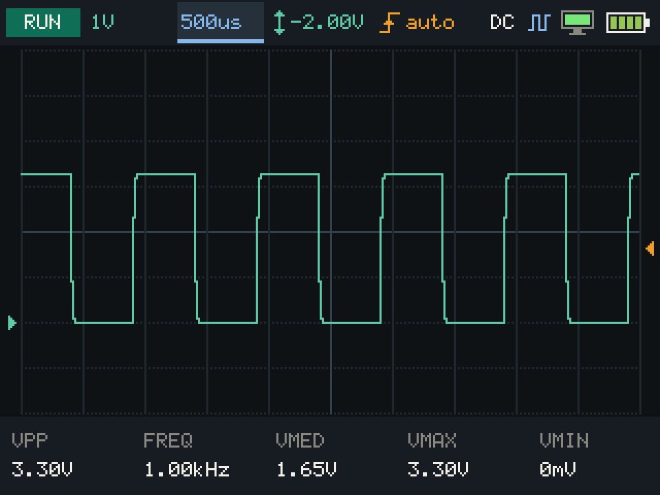

**Barra superior, da esquerda para a direita:**

| Item | Significado |
|---|---|
| **Estado** | **RUN** capturando · **MED** capturando com média · **NORM** trigger normal (laranja: esperando o disparo) · **SNGL** captura única · **ROLL** modo rolagem · **STOP** parado |
| **V/div** | escala vertical (laranja com a ponta em x10) |
| **tempo/div** | base de tempo |
| **↕ posição** | onde está o zero, em volts |
| **trigger** | borda (subida ou descida) e nível ("auto" = meio do sinal) |
| **DC / AC** | acoplamento da entrada |
| **gerador** | azul ligado; cinza com X vermelho desligado |
| **PC** | moldura cinza: sem PC · amarelo: PC conectado com a porta fechada · tela verde: transmitindo para a página do PC |
| **bateria** | nível em 4 barras; vermelho quando baixa; animação durante a carga |

O campo selecionado (o que as setas ▲ ▼ ajustam) fica destacado e sublinhado.

**Grade:** 10 divisões na horizontal e 8 na vertical. Os marcadores:

- **Triângulo verde à esquerda:** o zero (0 V) do sinal.
- **Triângulo laranja à direita:** o nível do trigger.
- **Triângulo laranja no topo:** a posição do disparo no tempo.

O marcador do campo selecionado fica maior. Ao mover o zero ou o nível do trigger, uma linha
tracejada atravessa a grade por 1,5 s para mostrar onde ele está.

**Barra inferior:** cinco medidas à escolha (seção 6) ou os valores dos cursores (seção 7).

**FORA DA ESCALA:** a faixa vermelha no topo da grade avisa que o sinal passa da tela, para cima
ou para baixo (indicado pela seta). As medidas de amplitude ficam erradas nesse caso: aumente o
V/div ou use AUTO.

## 4. Botões

| Botão | Função |
|---|---|
| **◄ ►** | escolhe o campo que ▲ ▼ ajustam: V/div → tempo/div → posição → trigger → disparo → (cursor 1 → cursor 2) |
| **▲ ▼** | muda o valor do campo escolhido (segurando, os cursores andam mais rápido) |
| **MODE** | DC / AC |
| **RUN** | roda / para. Em Single, arma uma nova captura |
| **AUTO** | ajuste automático de escala, posição e base de tempo |
| **OK** | abre o menu de configurações |
| **liga/desliga** | liga; segurando 2 s, desliga |

No **menu**, as setas escolhem o item e **OK** altera o valor ou abre o submenu. MODE, RUN ou
AUTO fecham o menu.

## 5. Usando o osciloscópio

### Escalas

- **V/div:** de **10 mV a 20 V por divisão** com a ponta x1 (100 mV a 200 V em x10).
- **Tempo/div:** de **20 µs a 2 s por divisão**. De **50 ms/div em diante** o aparelho entra no
  **modo rolagem**: a onda corre da direita para a esquerda, sem esperar o trigger, como num
  registrador gráfico. Serve para sinais lentos, como a carga de um capacitor ou a variação de
  uma bateria.
- **Posição:** move o zero para cima ou para baixo, em passos de 1/4 de divisão.

### AUTO

Mede o sinal em duas janelas de tempo (curta e longa) e escolhe V/div, posição e base de tempo
para mostrar cerca de três períodos. Funciona também com sinais lentos, de poucos hertz. Sem
sinal na entrada, vai para 100 mV/div e 1 ms/div.

### Trigger

O trigger "congela" a onda na tela, começando sempre no mesmo ponto do sinal.

- **Modo** (menu): **Auto** mostra a onda mesmo sem disparo · **Normal** só atualiza quando há
  disparo (o estado fica laranja enquanto espera) · **Single** captura uma vez e para (RUN arma
  de novo).
- **Borda** (menu): subida ou descida.
- **Nível:** selecione o campo do trigger e use ▲ ▼ (passos de 0,2 divisão). Enquanto estiver
  em "auto", o nível fica no meio do sinal.

### Posição do disparo (pré-trigger)

Depois do campo do trigger, **◄ ►** chegam ao campo **disparo**. Ele não tem lugar na barra
superior: o valor aparece no rodapé ("DISPARO") e o **triângulo laranja do topo** fica branco.
**▲ ▼** movem o ponto de disparo para a esquerda ou para a direita, em passos de meia divisão,
até 4,5 divisões para cada lado.

- Disparo à **direita**: mostra mais do que aconteceu **antes** do evento.
- Disparo à **esquerda**: mostra mais do que aconteceu **depois**.

**Com o aparelho parado (STOP)**, mover o disparo **percorre a captura**. O aparelho guarda o
dobro do que cabe na tela, então dá para ver o que ficou fora dela.

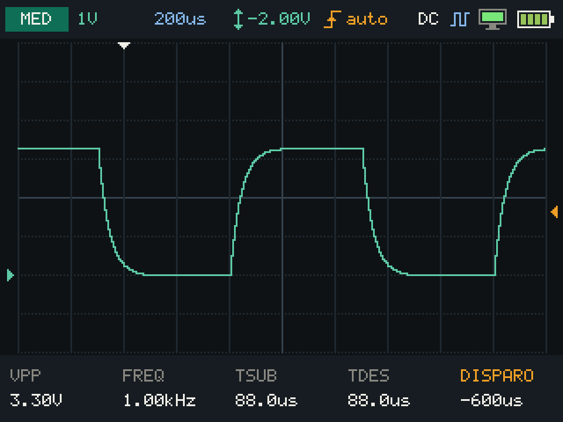

### Média de capturas

Menu → **Média de capturas**: Desligada, 4, 8 ou 16. O aparelho faz a média das últimas capturas
disparadas, o que **reduz o ruído** de sinais repetitivos e deixa as medidas mais estáveis. O
estado mostra **MED**.

- A média recomeça ao mudar a escala, o acoplamento, a posição do disparo ou ao usar AUTO.
- Só faz sentido com sinal repetitivo e bem disparado. Para eventos únicos use Single, sem média.
- Não vale no modo rolagem.

### DC e AC

**MODE** alterna o acoplamento. **DC** mostra o sinal inteiro, inclusive a parte contínua. **AC**
remove a parte contínua e mostra só a variação, útil para ver o ripple de uma fonte (por exemplo,
alguns milivolts sobre 12 V).

### Ponta x1 / x10

Menu → **Ponta de prova**. Ajuste para a **mesma posição da chave da ponta**. Em x10, todas as
leituras são multiplicadas por 10 e os valores de escala ficam em laranja.

## 6. Medidas

As cinco posições da barra inferior podem mostrar qualquer medida. Para trocar: Menu →
**Medidas na tela** → escolha a posição e aperte OK até chegar à medida desejada.
"Restaurar padrão" volta para VPP, FREQ, VMED, VMAX e VMIN.

| Rótulo | Medida | Observação |
|---|---|---|
| **VPP** | pico a pico | máximo menos mínimo |
| **FREQ** | frequência | precisa de pelo menos dois ciclos na tela |
| **PER** | período | 1 / frequência |
| **DUTY** | duty cycle | tempo em nível alto / período, em períodos inteiros |
| **VMED** | média | a parte contínua (DC) do sinal |
| **VRMS** | RMS verdadeiro | inclui a parte contínua; em AC, mostra só a parte alternada |
| **VMAX** | máximo | |
| **VMIN** | mínimo | |
| **TSUB** | tempo de subida | de 10 % a 90 % da borda, média das bordas na tela |
| **TDES** | tempo de descida | de 90 % a 10 % da borda |

**Tempo de subida e descida:** a resolução é de um ponto da captura, ou seja, 1/30 de divisão.
Para medir uma borda rápida, use a menor base de tempo em que a borda ainda apareça, e mais de uma
borda na tela.

As medidas são suavizadas entre capturas para o número não ficar "pulando".

## 7. Cursores

Menu → **Cursores**: Desligado, **Tempo** ou **Tensão**.

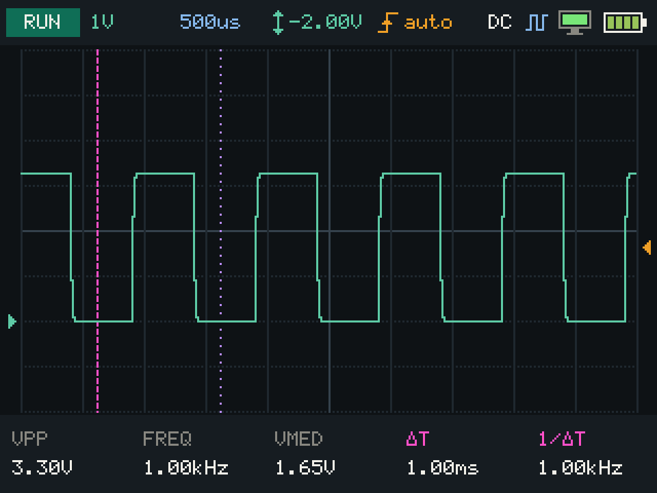
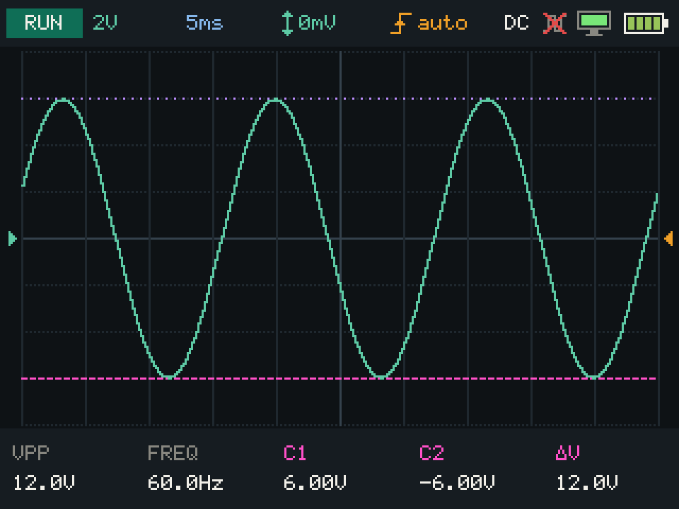

- **Tempo:** duas linhas verticais. O rodapé mostra **ΔT** (tempo entre elas) e **1/ΔT** (a
  frequência correspondente).
- **Tensão:** duas linhas horizontais. O rodapé mostra **C1**, **C2** e **ΔV**.

Com os cursores ligados, **◄ ►** chegam também ao **cursor 1** e ao **cursor 2**. O cursor
selecionado fica **rosa** com traço longo, e **▲ ▼** o movem. Segurando, ele anda mais rápido.

## 8. Multímetro

Menu → **Multímetro** → OK. O aparelho vira um voltímetro com todas as leituras ao mesmo tempo:
**VDC**, **VRMS**, **FREQ**, **VPP**, **VMAX** e **VMIN**. Uma delas aparece em destaque, em número
grande.

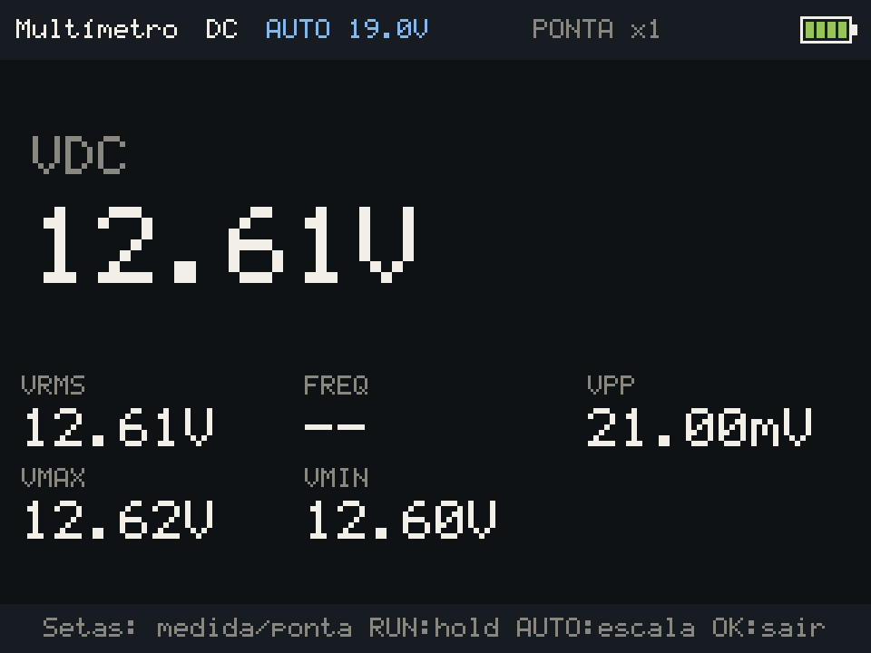
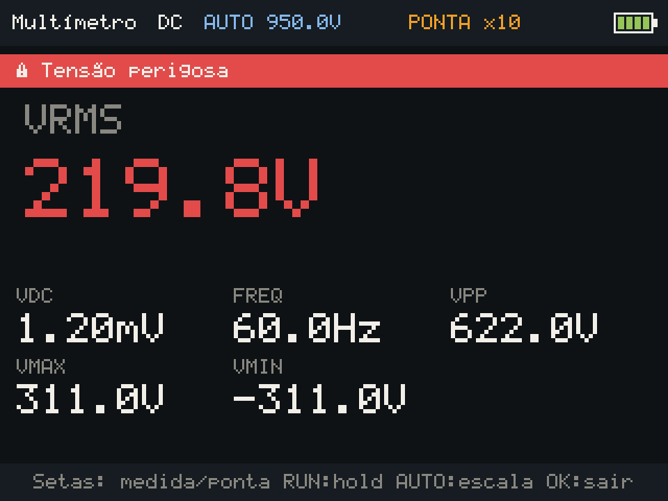

| Botão | Função no multímetro |
|---|---|
| **▲ ▼** | escolhe a medida em destaque |
| **◄ ►** | ponta x1 / x10 |
| **MODE** | DC / AC |
| **RUN** | congela a leitura (**HOLD**) |
| **AUTO** | escala automática ou fixa (veja abaixo) |
| **OK** | volta ao osciloscópio |

**Barra superior:** acoplamento, escala ("AUTO" ou "FIXA" e o fundo de escala), ponta (laranja em
x10), HOLD e bateria.

**Escala:**

- Em **AUTO**, a escala sobe quando o sinal passa do limite e desce quando ele fica pequeno.
- A primeira vez que você aperta **AUTO**, a escala **trava** na atual ("FIXA").
- Cada novo aperto passa para a escala seguinte; depois da última, volta para AUTO.
- Escalas com a ponta x1 (fundo de escala): 190 mV, 380 mV, 950 mV, 3,8 V, 9,5 V, 47,5 V e 95 V.
  Em x10, tudo vezes 10. Lembre do limite de cerca de 40 V da entrada em x1.
- Com escala fixa e sinal acima dela, aparece **FORA DA ESCALA** em vez do valor.

A escala fixa é útil para acompanhar uma tensão que sobe ou desce (a carga de uma bateria, por
exemplo) sem o número mudar de faixa no meio da leitura.

**Velocidade de leitura:** o aparelho escolhe sozinho a taxa de amostragem pela frequência do
sinal. Sinais contínuos e de baixa frequência (como 60 Hz) são lidos devagar, com o número
estável. Sinais rápidos (kHz) são lidos mais rápido para a frequência sair certa.

**Resolução e precisão:**

- Na menor escala, cada passo vale cerca de 0,1 mV. Com as pontas em curto é normal ler alguns
  décimos de milivolt.
- Precisão típica de 1 a 3 %. O ganho das escalas mais usadas foi aferido com multímetro.

O multímetro mede só **tensão**: o aparelho não tem circuito para corrente, resistência ou
continuidade.

## 9. Aviso de tensão perigosa

O aparelho avisa quando a tensão na ponta passa dos limites considerados seguros ao toque:

| Tipo | Aviso a partir de |
|---|---|
| Contínua (média) | **60 V** |
| Alternada | **30 V RMS** ou **42 V de pico** |

- **No multímetro:** a faixa vermelha "⚠ Tensão perigosa" aparece no topo, e o número em destaque
  fica **vermelho**.
- **No osciloscópio:** a onda e as cores não mudam. A linha dos nomes das medidas, no rodapé,
  **alterna a cada 2 segundos** com a faixa vermelha. Os valores continuam visíveis.

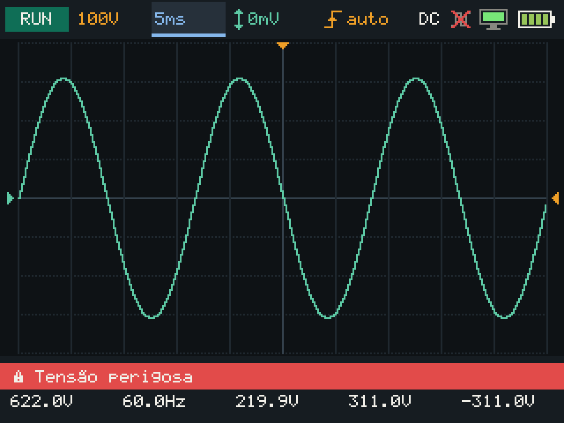

**Limite da entrada em x1:** com a ponta em x1 e 35 V ou mais, o aviso muda para
**"⚠ Acima do limite: use x10"**.

O aviso depende do ajuste x1 / x10 estar certo (seção 1). Ele é uma ajuda, não substitui os
cuidados de segurança.

## 10. Gerador de sinal

O conector de saída do aparelho gera uma **onda quadrada / pulso de 0 a 3,3 V**. É um sinal
lógico: aguenta poucos miliamperes e não serve para alimentar circuitos. O pino de saída não tem
conversor analógico, então não há senoide nem triângulo.

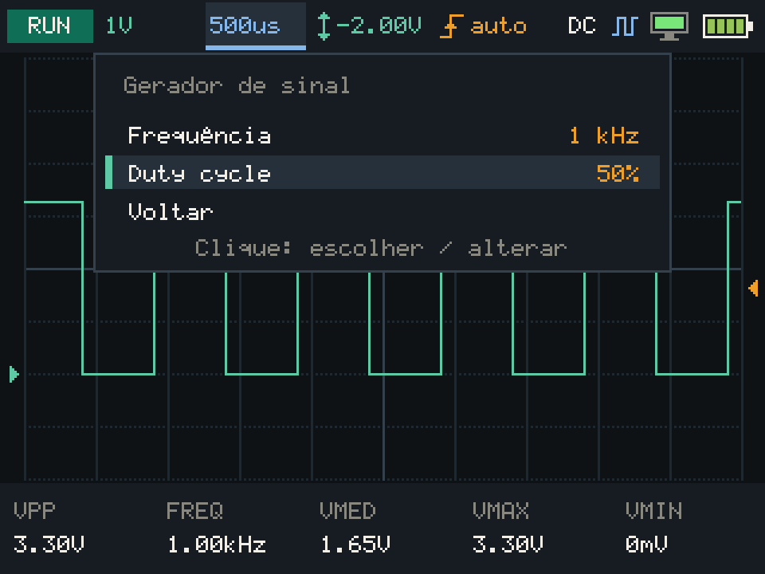

Menu → **Gerador de sinal ›**:

- **Frequência:** Desligado, 10, 50, 60, 100 e 500 Hz, 1, 5, 10, 50 e 100 kHz. Se houver uma
  frequência digitada no PC, ela também entra na lista.
- **Duty cycle:** 10, 25, 50, 75 e 90 %. É a porcentagem do tempo em que a saída fica em 3,3 V.
  Use para testar PWM: brilho de LED, velocidade de motor, servo.

**No PC** (seção 12), a frequência pode ser **digitada de 1 Hz a 200 kHz** e o duty de **1 a 99 %**.
A página mostra a frequência **realmente gerada**: o aparelho divide 72 MHz por números inteiros,
e em frequências altas o valor real pode diferir alguns décimos de porcento do pedido.

**Pulsos muito curtos:** com duty pequeno (ou grande) em frequência alta, o pulso pode ficar com
menos de 2 µs. A página avisa, porque a saída pode não reproduzir pulsos tão curtos.

## 11. Menu de configurações

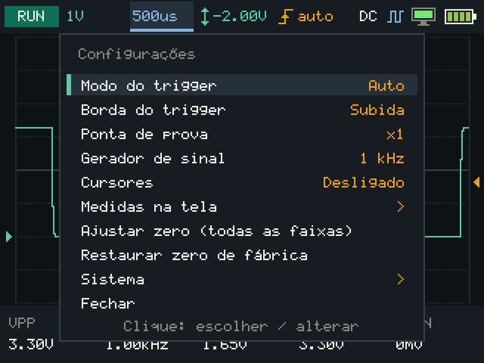
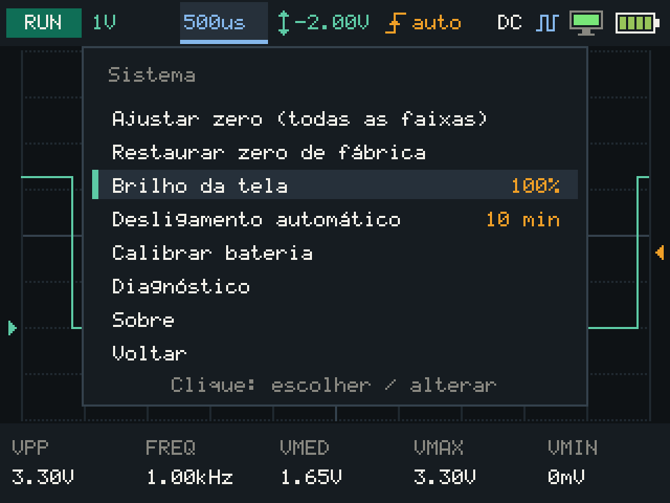

O **>** indica um submenu.

| Item | Valores / ação |
|---|---|
| **Multímetro** | abre o multímetro (seção 8) |
| **Modo do trigger** | Auto, Normal, Single |
| **Borda do trigger** | Subida, Descida |
| **Ponta de prova** | x1, x10 |
| **Cursores** | Desligado, Tempo, Tensão |
| **Média de capturas** | Desligada, 4, 8, 16 |
| **Gerador de sinal ›** | Frequência, Duty cycle |
| **Medidas na tela ›** | Posição 1 a 5, Restaurar padrão |
| **Sistema ›** | veja abaixo |
| **Fechar** | volta à tela |

**Sistema:**

| Item | Função |
|---|---|
| **Ajustar zero (todas as faixas)** | mede e grava o zero das 22 faixas (11 em DC, 11 em AC). Ligue a ponta ao jacaré, sem sinal, e confirme com OK. Se houver sinal na entrada, o ajuste é cancelado |
| **Restaurar zero de fábrica** | volta ao zero gravado pela FNIRSI no aparelho |
| **Brilho da tela** | 100, 75, 50 ou 25 % |
| **Desligamento automático** | Desligado, 5, 10 ou 30 min sem apertar botões. Só na bateria: com USB ou carregador ele não desliga sozinho. Avisa 30 s antes; qualquer botão cancela |
| **Calibrar bateria** | com a bateria **totalmente carregada** e o carregador retirado, OK faz a leitura atual valer 4,20 V (100 %). MODE volta ao valor padrão |
| **Diagnóstico** | versão, processador, memória, tempo ligado, USB, calibração, bateria e tensão interna |
| **Sobre** | versão, autor, licença e novidades |

## 12. Tela no PC

O aparelho, ligado ao PC pelo USB, envia a tela para uma página que abre no **Chrome** ou no
**Edge**, sem instalar nada. O Firefox não tem a função Web Serial, que a página usa.

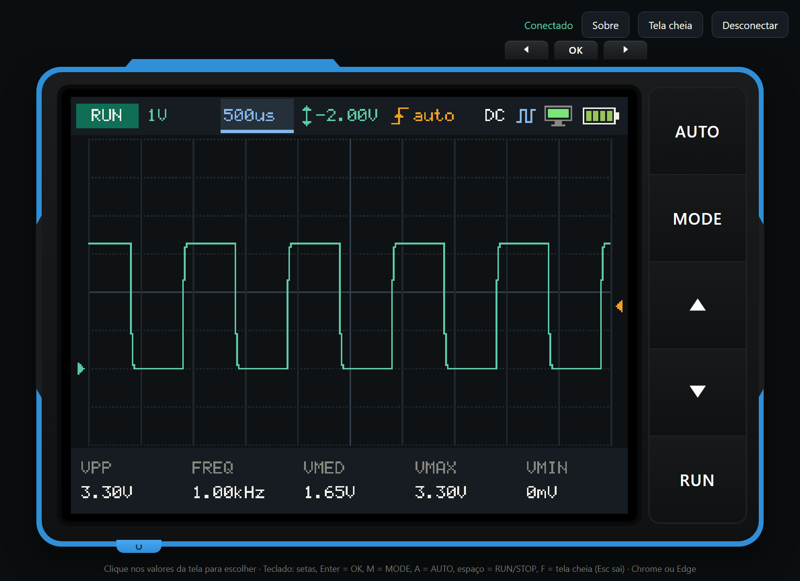

### Conectar

1. Ligue o aparelho ao PC com um cabo USB de dados. O ícone do PC fica **amarelo**. No Windows
   ele aparece como *Dispositivo serial USB (COMx)*, com o driver do próprio Windows.
2. Abra `dso152_pc.html` no Chrome ou no Edge.
3. Clique em **Conectar** e escolha a porta. O ícone fica com a tela **verde**.

### Operar pelo PC

- **Botões:** os botões desenhados ao lado da tela funcionam como os do aparelho. OK e as setas
  ◄ ► ficam no topo, como no aparelho.
- **Teclado:** setas, Enter = OK, M = MODE, A = AUTO, espaço = RUN/STOP, F = tela cheia (Esc sai).
- **Clique nos valores da tela** para escolher em uma lista:

| Onde clicar | Lista |
|---|---|
| V/div | escalas, ponta x1/x10, acoplamento |
| tempo/div | bases de tempo e média de capturas |
| posição | posição do zero |
| trigger | nível, borda e modo |
| triângulo do topo | posição do disparo e média |
| ícone do gerador | frequências, frequência digitada, "Outra frequência / duty…" |
| DC / AC | alterna |
| RUN | roda / para |
| medidas do rodapé | medida daquela posição e cursores |

- **Menu do aparelho:** quando o menu está aberto, ele aparece na página e os itens podem ser
  clicados.
- **Multímetro:** a página mostra a mesma tela do multímetro. Clicar no acoplamento, na escala,
  na ponta, no HOLD ou na medida em destaque funciona como os botões correspondentes.
- **Tela cheia:** o botão **Tela cheia** (ou F) mostra só a tela, em alta resolução e formato wide.
- **Desligar:** o botão **⏻ Desligar** (ou o botão azul embaixo do gabinete desenhado) pergunta na
  própria tela e desliga o aparelho. Para ligar de novo é preciso o botão do aparelho.

### Histórico e exportação

- **Histórico:** a página guarda as últimas **3000 capturas**. **Congelar** para a tela no PC sem
  parar o aparelho, e a barra deslizante volta a capturas anteriores.
- **Salvar imagem (PNG):** a tela em 1920×1080.
- **Exportar onda (CSV):** amostra, tempo e tensão de cada ponto, com vírgula decimal e
  ponto e vírgula, para abrir direto no Excel em português.
- **Gravar vídeo (WebM):** grava a tela em 1280×720 até você clicar em parar. O arquivo abre no
  navegador, no VLC e no WhatsApp.
- **Guardar referência:** guarda a onda atual e a desenha em **cinza** por trás das novas, para
  comparar (antes e depois de um ajuste, peça boa e peça com defeito). A referência é redesenhada
  nas escalas atuais. **Limpar referência** a remove.

### Gerador de sinal

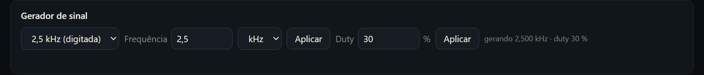

A lista tem as frequências fixas. Para outra frequência, digite o valor, escolha **Hz** ou
**kHz** ao lado (por exemplo 15 Hz ou 2,5 kHz), de 1 Hz a 200 kHz, e clique em **Aplicar**
(ou Enter). O duty, de 1 a 99 %, tem o seu próprio **Aplicar**. À direita aparece a
frequência realmente gerada.

### Espectro (FFT)

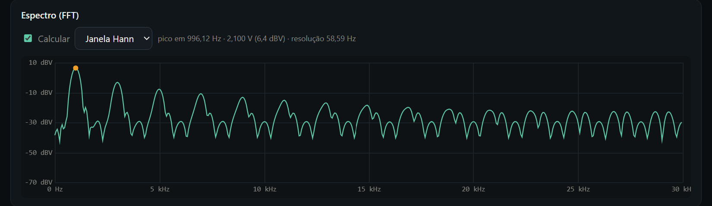

Marque **Calcular** para ver as frequências que compõem a onda da tela, em dBV (0 dBV = 1 V). O
ponto laranja marca o pico, com frequência e amplitude. Uma onda quadrada mostra as harmônicas
ímpares (3×, 5×, 7×…); o ruído de uma fonte chaveada aparece como picos na frequência de
chaveamento.

- A janela **Hann** reduz o "vazamento" entre frequências vizinhas; **Sem janela** mostra a
  amplitude exata de sinais com número inteiro de períodos na tela.
- A FFT usa os 300 pontos da tela. A resolução, mostrada ao lado, é a taxa de amostragem dividida
  por 512. Para separar frequências próximas, use uma base de tempo mais lenta.
- A frequência máxima é metade da taxa de amostragem da base de tempo atual.

### Decodificação serial (UART)

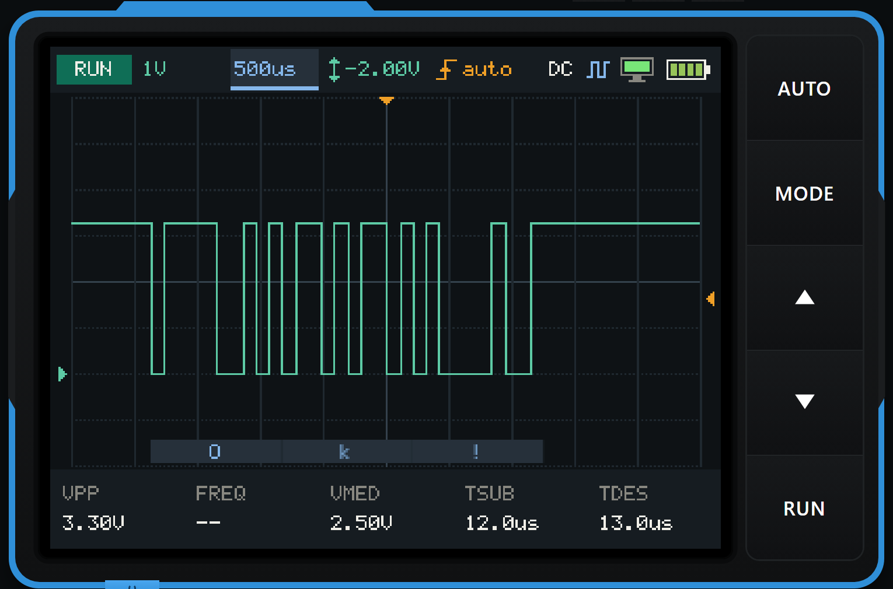

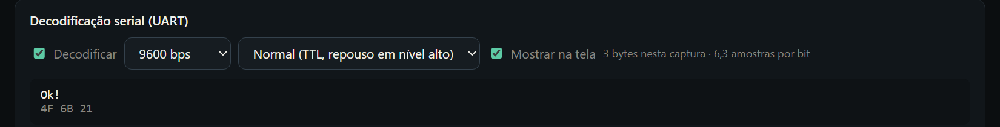

Lê o texto de uma serial assíncrona (o TX de um Arduino, ESP32, módulo GPS…), formato **8N1**.

1. Ligue a ponta ao pino TX e o jacaré ao GND do circuito.
2. Marque **Decodificar** e escolha a velocidade (9600, 115200…).
3. **Polaridade:** Normal para níveis TTL (repouso em nível alto); Invertido para sinais
   invertidos (repouso em nível baixo).
4. Ajuste a base de tempo para caber alguns caracteres na tela, com pelo menos 3 pontos por
   bit. Se faltar, a página diz qual base de tempo usar.

Os bytes aparecem sobre a onda (desmarque "Mostrar na tela" para escondê-los) e no quadro abaixo,
como texto e em hexadecimal. Bytes com erro de quadro aparecem em vermelho e com "!".

A decodificação vale para a captura que está na tela, não para um fluxo contínuo. Para mensagens
longas, use Single ou STOP e percorra a captura com a posição do disparo.

### Registrador

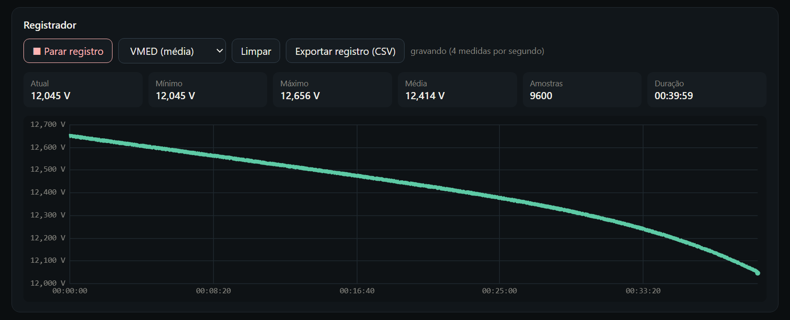

Grava uma medida ao longo do tempo (minutos ou horas), com 4 pontos por segundo: VMED, VPP,
VRMS, VMAX, VMIN, frequência ou duty cycle. Mostra atual, mínimo, máximo, média, número de
amostras e duração, e exporta em CSV. Também funciona com o multímetro aberto.

## 13. Dicas de medição

- **Rede elétrica (127/220 V):** ponta e aparelho em **x10**, aparelho **fora do USB e do
  carregador**, garra no neutro. Use o multímetro para ler o RMS e a frequência, ou 5 ms/div no
  osciloscópio para ver a forma da onda.
- **Ripple de fonte:** acoplamento **AC**, V/div baixo (10 a 50 mV) e média de 8 ou 16.
- **Sinais lentos** (bateria, sensor, carga de capacitor): base de tempo de 50 ms/div ou mais
  (modo rolagem), ou o registrador no PC.
- **PWM:** meça FREQ e DUTY no rodapé. Para testar um circuito sem programar uma placa, use o
  gerador com o duty desejado.
- **Bordas de sinais digitais:** TSUB e TDES, com a base de tempo mais rápida que ainda mostre
  a borda inteira.
- **Comunicação serial:** decodificação UART no PC (seção 12).
- **Teste rápido do aparelho:** ligue a ponta à saída do gerador (1 kHz) e aperte AUTO. Deve
  aparecer uma quadrada de cerca de 3,3 V e 1 kHz. Se as bordas aparecerem arredondadas ou com
  picos, ajuste o trimmer de compensação da ponta x10.

## 14. Solução de problemas

| Sintoma | O que fazer |
|---|---|
| O Chrome diz "nenhum dispositivo compatível encontrado" | Use um cabo USB de **dados** (alguns cabos só carregam). Confira se o ícone do PC na tela do aparelho ficou amarelo. Em máquina virtual, passe o dispositivo USB para ela |
| A página não tem o botão Conectar funcionando | Use o Chrome ou o Edge; o Firefox não tem Web Serial |
| A leitura sai 10 vezes menor ou maior | A chave da ponta e o ajuste x1/x10 do aparelho não batem (menu → Ponta de prova) |
| A onda não para na tela | Ajuste o nível do trigger ou volte para "auto"; confira a borda e o modo |
| Em Normal a tela não atualiza | Não há disparo: o nível está fora do sinal. Use Auto ou ajuste o nível |
| A linha de zero está deslocada sem sinal | Menu → Sistema → Ajustar zero, com a ponta ligada ao jacaré |
| A bateria mostra um nível errado | Menu → Sistema → Calibrar bateria, com a bateria cheia |
| O aparelho desliga sozinho | Desligamento automático ligado (Sistema). Ele só age na bateria |
| A tela do DSO BOOT aparece com barras | Firmware compilado sem o arquivo original da FNIRSI (veja o README). Não afeta o funcionamento |
| Quero voltar ao firmware original | Segure OK ao ligar e copie o arquivo da FNIRSI para o drive DSO BOOT |

## 15. Especificações

| Item | Valor |
|---|---|
| Entradas | 1 canal, BNC |
| Escalas verticais | 10 mV a 20 V/div (x1), 100 mV a 200 V/div (x10), 11 faixas de hardware |
| Base de tempo | 20 µs a 2 s/div; modo rolagem a partir de 50 ms/div |
| Amostragem | até 2,4 milhões de pontos por segundo; 600 pontos por captura, 300 na tela |
| Banda | cerca de 200 kHz (hardware) |
| Trigger | Auto, Normal, Single; subida ou descida; nível automático ou manual; posição ajustável |
| Medidas | VPP, frequência, período, duty, média, RMS verdadeiro, máximo, mínimo, subida, descida |
| Multímetro | VDC, VRMS, frequência, VPP, máximo, mínimo; escala automática ou fixa |
| Gerador | quadrada / pulso 0–3,3 V; 1 Hz a 200 kHz; duty 1 a 99 % |
| Tela | 320 × 240, colorida |
| PC | USB serial (CDC), página Web Serial para Chrome e Edge |
| Processador | CH32F103 (compatível com STM32F103), 72 MHz |

---

DSO152 — firmware alternativo · Carlos Santa Kich · Licença [MIT](../LICENSE).
Este projeto não tem relação com a FNIRSI. FNIRSI e DSO-152 são marcas dos seus donos.
